  

  

**sreynosolabs** is the studio of **Sebastián Reynoso**, a software engineer based in Peru. 
I design and build software for businesses, from the first conversation to production: 
**with AI, in days, not months**, and without cutting corners.

 

## ◆ What I build

<table>
  <tr>
    <td width="50%" valign="top">
      <h3>🌐 High-impact websites</h3>
      Fast, secure websites you can manage yourself, designed so customers find you, trust you and get in touch.
    </td>
    <td width="50%" valign="top">
      <h3>🧭 Custom dashboards and apps</h3>
      Invoicing, collections, inventory, KPIs: the system that replaces the spreadsheet and works exactly the way your business does.
    </td>
  </tr>
  <tr>
    <td width="50%" valign="top">
      <h3>🔌 System and API integrations</h3>
      I connect your software with providers, platforms and AI assistants so data flows on its own, securely and without manual copying.
    </td>
    <td width="50%" valign="top">
      <h3>✨ AI automation</h3>
      AI built in where it truly saves time: product sheets completed from an assistant's answer, AI-generated routines you can import, and data ready for an assistant to query.
    </td>
  </tr>
  <tr>
    <td colspan="2" valign="top">
      <h3>🎨 Complete brand identity</h3>
      Logo, brand guidelines, brochure, catalog, quote templates, email signatures and website: everything your company needs to present itself, designed as one system.
    </td>
  </tr>
</table>

Not on the list? If it's software, I build it.

 

 

## ◆ Selected work

Businesses that run today on software I built from idea to production.

| | Project | What it does |
|:-:|:--|:--|
| 🚚 | **[Taleon Motors](https://sreynosolabs.com/en/projects/taleon-motors/)** | A website with catalog, quotes and its own admin panel, to sell trucks without depending on anyone. |
| 🏭 | **[Proveedores & Soluciones Industriales · Rebrand](https://sreynosolabs.com/en/projects/proveedores-soluciones-rebranding/)** | A rebrand from scratch: strategy, logo, guidelines, website, brochure, catalog and signatures working as one system. |
| 📊 | **[Proveedores & Soluciones Industriales · Invoicing](https://sreynosolabs.com/en/projects/proveedores-soluciones-industriales/)** | A desktop app that replaced a spreadsheet of thousands of rows and brought the numbers up to date. |
| 🛞 | **[Grupo IAP](https://sreynosolabs.com/en/projects/grupo-iap/)** | A landing page with a 3D tire that shows everything the company does and turns visits into quotes. |
| 🌿 | **[Shelah Torreblanca](https://sreynosolabs.com/en/projects/shelah-torreblanca/)** | A website that brings all her services together and turns every visit into a WhatsApp booking. |
| 🏋️ | **[Training Companion](https://sreynosolabs.com/en/projects/training-companion/)** | In-house product: a training app that works offline and keeps your history ready for an AI to tune your routine. |
| 💸 | **[FinanzasApp](https://sreynosolabs.com/en/projects/finanzasapp/)** | In-house product: multi-currency personal finance, with installment debts and budgets that warn you before you overspend. |

> [!NOTE]
> **Why are the repositories private?** Client code belongs to the client. Each case study on the website shows the problem, the decisions and the result, and I'm happy to walk you through any project on a video call.

 

## ◆ Built to last

<table>
  <tr>
    <td width="33%" valign="top">
      <h4>🏢 Enterprise background</h4>
      7+ years of production software for insurance, banking and travel. Today I design the connectors that link travel platforms with OUIGO, Nezasa and 30+ airlines through Lleego.
    </td>
    <td width="33%" valign="top">
      <h4>🛡️ Quality you don't see</h4>
      Automated tests on what matters, deployments with rollback and high Lighthouse scores, so what works today keeps working tomorrow.
    </td>
    <td width="33%" valign="top">
      <h4>🤝 Clear deal</h4>
      Fixed price per project, never by the hour. I train your team so you don't depend on anyone for day-to-day changes.
    </td>
  </tr>
</table>

 

### Let's talk about your project

Tell me what your business needs. I'll answer personally and we'll define the scope together.

Made in Peru · Spanish and English

 

<b>🇵🇪 Leer en español</b>

 

### Construyo el software con el que funciona tu negocio.

**sreynosolabs** es el estudio de **Sebastián Reynoso**, ingeniero de software en Perú. Diseño y construyo software para negocios, de la primera conversación a producción: **con IA, en días, no en meses**, y sin atajos.

#### Qué construyo

- **Webs de alto impacto:** sitios rápidos, seguros y administrables por ti, diseñados para que tus clientes te encuentren, confíen y te escriban.
- **Paneles y apps a medida:** facturación, cobros, inventario, indicadores: el sistema que reemplaza al Excel y hace el trabajo exactamente como lo hace tu negocio.
- **Integraciones entre sistemas y APIs:** conecto tu software con proveedores, plataformas y asistentes de IA para que los datos fluyan solos, con seguridad y sin copiar a mano.
- **Automatización con IA:** IA integrada donde ahorra tiempo de verdad.
- **Marca e identidad completa:** logo, manual de marca, brochure, catálogo, cotizaciones, firmas y web, diseñados como un solo sistema.

¿Lo tuyo no está en la lista? Si es software, lo construyo.

#### Cómo trabajo

Entender el negocio → Diseñar → Construir → Probar → Publicar → Capacitar → Acompañar. **Precio cerrado por proyecto, nunca por hora.**

#### Proyectos

Todos los casos, con el problema, las decisiones y el resultado, están en **[sreynosolabs.com](https://sreynosolabs.com/es/#projects)**. Los repositorios son privados porque el código es de cada cliente: te muestro cualquier proyecto en una videollamada.

#### Hablemos de tu proyecto

Cuéntame qué necesita tu negocio; te respondo personalmente y definimos el alcance juntos.

[WhatsApp](https://wa.me/51928799436?text=Hola%20Sebasti%C3%A1n%2C%20te%20encontr%C3%A9%20en%20GitHub%20y%20quiero%20hablar%20de%20un%20proyecto.) · [hola@sreynosolabs.com](mailto:hola@sreynosolabs.com) · [sreynosolabs.com](https://sreynosolabs.com/es/)

